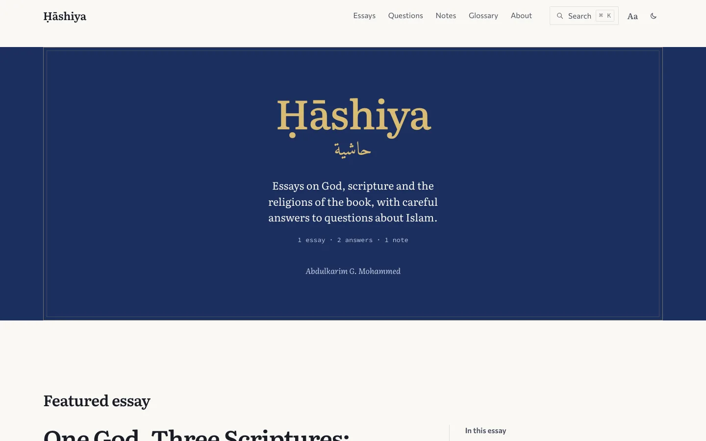
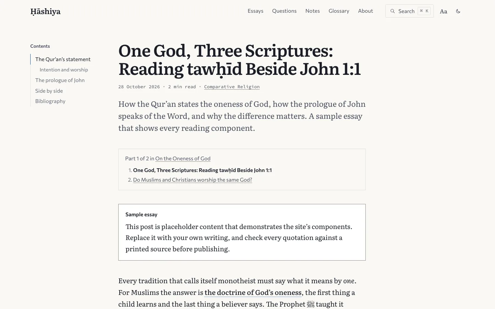

<div align="center">

# Ḥāshiya · حاشية

**A journal of theology, comparative religion, and careful answers to questions about Islam.**

[**blog.abdulkarimg.com**](https://blog.abdulkarimg.com) · [Design system](DESIGN.md) · [Write a post](#writing) · [Deploy](#deployment)

[](https://nextjs.org)
[](https://tailwindcss.com)
[](https://workers.cloudflare.com)
[](#quality)
[](LICENSE)

<picture>
  <source media="(prefers-color-scheme: dark)" srcset="docs/screenshots/home-dark.webp">
  
</picture>

</div>

## About

A _ḥāshiya_ is a marginal gloss: the notes a reader writes beside a text while studying it. This journal is a gloss in that sense. It is written by Abdulkarim G. Mohammed, a student of knowledge, for Muslims who want depth and for readers of other faiths or none who want to understand.

The design treats the site as a clothbound scholarly edition: lapis cloth frames white paper, gold is reserved for scripture, and the gloss lives in the margin. Primary texts are always quoted in full with their reference and translator, set apart from the commentary.

<picture>
  <source media="(prefers-color-scheme: dark)" srcset="docs/screenshots/post-dark.webp">
  
</picture>

## Features

- **Scripture components.** Qur'an, ḥadīth and other scripture blocks, each visually distinct from commentary, with references, translators, grades and a copy button.
- **Arabic done properly.** Arabic typed straight into Markdown is marked `lang="ar" dir="rtl"` and set in Amiri; Qur'anic text in Amiri Quran. ﷺ, transliteration marks (ʿ ʾ) and curly quotes are typeset at build time.
- **Margins that work.** Tufte-style side notes and footnote copies in the right margin, a sticky contents list in the left; both collapse gracefully on phones and work without JavaScript.
- **Four kinds of writing.** Essays, Q&A posts (short answer first), notes, and multi-part series.
- **A glossary.** Inline terms open a definition; every term is collected on `/glossary`, A–Z.
- **Search.** ⌘K / Ctrl+K / `/` opens a palette backed by [Pagefind](https://pagefind.app): static, grouped by type, includes glossary terms, and finds vocalized Arabic from plain typing.
- **Reading preferences.** Text size, serif or sans, and light / dark / system, applied before first paint.
- **Distribution.** RSS (site-wide, per subject, per tag), sitemap, canonical URLs, JSON-LD (`BlogPosting`, `QAPage`, `BreadcrumbList`), and a generated Open Graph card per post with correctly shaped Arabic.
- **Built to last.** Fully static, self-hosted fonts, no tracking by default, strict security headers, and a print stylesheet.

## Tech stack

| Layer           | Choice                                                                                                           |
| --------------- | ---------------------------------------------------------------------------------------------------------------- |
| Framework       | [Next.js 15](https://nextjs.org) (App Router, static export), React 19, TypeScript                               |
| Styling         | [Tailwind CSS 4](https://tailwindcss.com) with design tokens as CSS custom properties; `@tailwindcss/typography` |
| Content         | MDX via [Contentlayer2](https://github.com/timlrx/contentlayer2), custom rehype plugins, rehype-citation, KaTeX  |
| UI primitives   | Radix Popover and Dialog (loaded on demand), sonner                                                              |
| Search          | [Pagefind](https://pagefind.app)                                                                                 |
| Social cards    | Satori + resvg, with Arabic shaped by HarfBuzz                                                                   |
| Hosting         | [Cloudflare Workers](https://developers.cloudflare.com/workers/static-assets/) static assets                     |
| Package manager | Yarn 3 (bundled in `.yarn/releases`)                                                                             |

## Getting started

**Prerequisites:** Node.js 22 or newer (pinned in [`.nvmrc`](.nvmrc)). Yarn comes with the repository.

```bash
git clone https://github.com/Mr-MaNia7/abdulkarimg-blog.git
cd abdulkarimg-blog
yarn install
yarn dev          # http://localhost:3000
```

Search reads the index from the last build, so run `yarn build` once before trying ⌘K locally.

### Scripts

| Command                             | What it does                                                               |
| ----------------------------------- | -------------------------------------------------------------------------- |
| `yarn dev`                          | Development server with hot reload                                         |
| `yarn build`                        | Production build: Open Graph cards, Next.js build, RSS feeds, search index |
| `EXPORT=1 UNOPTIMIZED=1 yarn build` | The static site in `out/`, exactly as deployed (adds `out/_headers`)       |
| `yarn serve`                        | Serve the last production build                                            |
| `yarn lint`                         | ESLint (fixes what it can)                                                 |
| `yarn tsc --noEmit`                 | Type-check                                                                 |
| `yarn icons`                        | Regenerate favicons and the web manifest                                   |
| `yarn analyze`                      | Bundle analysis                                                            |

## Writing

Posts are MDX files in [`data/blog/`](data/blog). The file name is the URL: `data/blog/the-names-of-god.mdx` → `/blog/the-names-of-god/`.

### Frontmatter

| Field                    | Required | Notes                                                                                                        |
| ------------------------ | -------- | ------------------------------------------------------------------------------------------------------------ |
| `title`                  | yes      | Arabic, ʿ ʾ and ﷺ are fine; they are typeset automatically.                                                  |
| `date`                   | yes      | `'2026-11-02'`                                                                                               |
| `type`                   |          | `essay` (default), `qa`, or `note`                                                                           |
| `category`               |          | `Theology`, `Comparative Religion`, `Questions on Islam`, or `Notes`                                         |
| `summary`                |          | One or two sentences, shown under the title, in lists, feeds and search                                      |
| `tags`                   |          | `['tawhid', 'scripture']`                                                                                    |
| `series`                 |          | `{ name: 'The Names of God', part: 2 }`                                                                      |
| `question`               | Q&A only | The question in full, if it differs from the title                                                           |
| `short_answer`           | Q&A only | Two or three sentences shown before the full answer                                                          |
| `featured`               |          | `true` makes it the home page's featured essay                                                               |
| `layout`                 |          | `PostLayout` (default, with margins), `PostSimple` (one column), `PostBanner` (one column with a wide image) |
| `lastmod`                |          | Shown as "revised …"                                                                                         |
| `draft`                  |          | `true` hides the post in production                                                                          |
| `bibliography`           |          | e.g. `references.bib` in `data/`, to enable citations                                                        |
| `images`, `canonicalUrl` |          | Override the social image or canonical URL                                                                   |

The build stops with a clear message if a Q&A post lacks `question` or `short_answer`, or if two posts claim the same series part.

<details>
<summary><b>Examples: an essay, a question, a note, a series</b></summary>

**Essay**

```mdx
---
title: 'The Names of God in the Qur’an'
date: '2026-11-02'
type: essay
category: Theology
summary: What it means that God names Himself, and why the names are not interchangeable.
tags: ['tawhid', 'names-of-god']
series: { name: 'The Names of God', part: 1 }
bibliography: references.bib
---

Opening paragraph…

## First section
```

**Question** (listed on `/questions` and marked up as a `QAPage`)

```mdx
---
title: 'Is the Qur’an the same in every copy?'
date: '2026-11-05'
type: qa
category: Questions on Islam
layout: PostSimple
question: 'Have different versions of the Qur’an existed, and is today’s text the same everywhere?'
short_answer: 'Two or three sentences that answer directly. The rest of the post gives the reasoning and the sources.'
tags: ['quran']
---
```

**Note**

```mdx
---
title: 'A note on transliteration'
date: '2026-10-18'
type: note
category: Notes
layout: PostSimple
---
```

**Series:** give each part the same `series.name` and its own `part`. Each part shows the series contents at the top and previous/next parts at the end; `/series/<name>` lists them all.

</details>

### Components

Available in every post without imports. Components show only what you write: nothing is fetched or filled in, so **check every quotation against a printed source**.

<details>
<summary><b><code>&lt;Quran&gt;</code></b>: a Qur'an passage</summary>

```mdx
<Quran
  ref="2:255"
  arabic="ٱللَّهُ لَآ إِلَٰهَ إِلَّا هُوَ …"
  translation="Allah – there is no deity except Him …"
  translator="Sahih International"
/>
```

Arabic in Amiri Quran, translation beneath, `QUR’AN 2:255` in gold, and a Copy button (Arabic, translation and reference). A single verse gets the end-of-verse marker; a range (`112:1-4`) does not.

</details>

<details>
<summary><b><code>&lt;Hadith&gt;</code></b>: a ḥadīth report</summary>

```mdx
<Hadith
  collection="Sahih al-Bukhari"
  number="1"
  grade="Sahih"
  narrator="Narrated by ʿUmar ibn al-Khaṭṭāb"
  arabic="إِنَّمَا الأَعْمَالُ بِالنِّيَّاتِ"
>
  Actions are only by intentions.
</Hadith>
```

`grade` is `Sahih`, `Hasan` or `Daif` (shown as Ṣaḥīḥ, Ḥasan, Ḍaʿīf) or any other text. `number`, `grade`, `narrator` and `arabic` are optional.

</details>

<details>
<summary><b><code>&lt;Scripture&gt;</code></b>: the Bible, Torah and other texts</summary>

```mdx
<Scripture
  tradition="Bible"
  ref="John 1:1"
  version="ESV"
  original="Ἐν ἀρχῇ ἦν ὁ λόγος"
  originalLang="grc"
>
  In the beginning was the Word …
</Scripture>
```

`original` and `originalLang` (a language tag such as `he`, `grc`, `syc`) are optional; right-to-left languages are detected.

</details>

<details>
<summary><b><code>&lt;Compare&gt;</code></b>: two traditions side by side</summary>

```mdx
<Compare
  caption="A simplified comparison."
  rows={['God', 'Revelation']}
  left={{ label: 'Islam', items: ['Absolutely one', 'The Qur’an'] }}
  right={{ label: 'Christianity', items: ['One God in three persons', 'The Word made flesh'] }}
/>
```

A real table: rows align by position and stack into labelled blocks on phones.

</details>

<details>
<summary><b><code>&lt;Sidenote&gt;</code></b>, footnotes and citations</summary>

```mdx
The doctrine is first.<Sidenote>A short aside, shown in the margin.</Sidenote>

A claim.[^1] A citation [@nasr2015study].

## Bibliography

[^1]: The footnote text.
```

Side notes are lettered (a, b, c): in the margin on wide screens, opened by tapping the letter on phones, with no JavaScript needed. Footnotes are numbered, listed under "Notes" with backlinks, and copied into the margin on wide screens. Citations need `bibliography:` in the frontmatter and a BibTeX file in `data/` (see [`data/references.bib`](data/references.bib)).

</details>

<details>
<summary><b><code>&lt;Term&gt;</code></b>: an inline glossary term</summary>

```mdx
<Term translit="tawḥīd">the oneness of God</Term>
<Term translit="isnād" />
```

Opens a popover with the Arabic, transliteration and definition, and links to `/glossary`. Entries live in [`data/glossary.json`](data/glossary.json):

```json
{ "id": "tawhid", "translit": "tawḥīd", "ar": "توحيد", "definition": "…" }
```

The `id` is the transliteration without diacritics; pass `id="…"` when it differs.

</details>

<details>
<summary><b><code>&lt;Callout&gt;</code>, <code>&lt;PullQuote&gt;</code>, <code>&lt;Figure&gt;</code></b></summary>

```mdx
<Callout type="note">…</Callout> {/* note | important | clarification; optional title="…" */}

<PullQuote>A line from the essay, set large.</PullQuote>

<Figure
  src="/static/images/notes/chart.svg"
  alt="What the image shows"
  width={1200}
  height={680}
  caption="…"
  credit="…"
  wide
/>
```

Put images in `public/static/images/`. `wide` lets a figure extend into the right margin.

</details>

## Configuration

| File                                                   | What to change                                                                                    |
| ------------------------------------------------------ | ------------------------------------------------------------------------------------------------- |
| [`data/siteMetadata.js`](data/siteMetadata.js)         | Title, description, author, social links (empty ones are hidden), analytics, comments, newsletter |
| [`data/authors/default.mdx`](data/authors/default.mdx) | The About page                                                                                    |
| [`data/glossary.json`](data/glossary.json)             | Glossary terms                                                                                    |
| [`security-headers.js`](security-headers.js)           | Content Security Policy and caching, written to `out/_headers`                                    |
| [`wrangler.jsonc`](wrangler.jsonc)                     | Cloudflare deployment                                                                             |

Optional services are off until configured:

- **Newsletter:** set `newsletter.formAction` to your provider's hosted form URL, and `fieldName` (e.g. `email_address` for Kit). The footer form then posts there directly, with no JavaScript needed.
- **Comments:** Giscus appears once its `NEXT_PUBLIC_GISCUS_*` variables are set (see [`.env.example`](.env.example)).
- **Analytics:** renders only once a provider id is set.

> [!IMPORTANT]
> When you enable analytics or comments, add their hosts to `thirdParty` in `security-headers.js`, or the browser will block them.

Fonts are self-hosted (`assets/fonts/web`, `public/fonts/v1`), so builds need no network. If you replace an Arabic font file, rename the folder `v1` → `v2`; those files are cached for a year.

## Deployment

The site is fully static and deploys to **Cloudflare Workers** static assets. [`wrangler.jsonc`](wrangler.jsonc) serves `out/`, applies `out/_headers`, uses `out/404.html` for unknown URLs, disables the `*.workers.dev` copy, and keeps per-version preview URLs.

1. In the Cloudflare dashboard, open **Workers & Pages → Create → Import a repository** and choose this repository.
2. Use these settings:

   | Setting         | Value                               |
   | --------------- | ----------------------------------- |
   | Build command   | `EXPORT=1 UNOPTIMIZED=1 yarn build` |
   | Deploy command  | `npx wrangler deploy`               |
   | Preview command | Cloudflare's default                |
   | Build variable  | `NODE_VERSION` = `22`               |

   Leave **Protect with Cloudflare Access** off.

3. Attach the domain: **Settings → Domains & Routes → Add → Custom domain → `blog.abdulkarimg.com`**. Cloudflare creates the DNS record and certificate.

Every push to `main` deploys (about four minutes); other branches get preview URLs. Check the headers after a deploy:

```bash
curl -sI https://blog.abdulkarimg.com/ | grep -i "content-security-policy\|cf-ray"
```

<details>
<summary>Cloudflare Pages instead</summary>

**Workers & Pages → Create → Pages → Connect to Git**: build command `EXPORT=1 UNOPTIMIZED=1 yarn build`, output directory `out`, `NODE_VERSION=22`. Pages ignores `wrangler.jsonc` and reads `out/_headers` directly.

</details>

## Project structure

```text
.
├── app/                    Routes: home, /blog, /essays, /questions, /notes, /glossary,
│                           /tags, /category, /series, /about, and posts
├── components/
│   ├── mdx/                Quran, Hadith, Scripture, Compare, Sidenote, Term, Callout, …
│   ├── post/               Post header, contents, series navigation, end matter
│   ├── index/              Archive lists and the questions index
│   ├── masthead/           Navigation, search trigger, reading preferences, theme toggle
│   └── search/             The ⌘K palette
├── layouts/                PostLayout, PostSimple, PostBanner
├── lib/                    Typesetting plugins, content queries, JSON-LD
├── css/                    Tokens and prose, reading, pages, chrome, motion, print
├── data/                   Posts, glossary, bibliography, About page, site metadata
├── scripts/                Open Graph cards, RSS feeds, search index, _headers
├── assets/                 Self-hosted fonts (SIL Open Font License)
├── public/                 Static files and Arabic fonts
├── security-headers.js     Security and cache headers (Next.js and Cloudflare)
├── wrangler.jsonc          Cloudflare Workers deployment
├── DESIGN.md               The design system
└── PRODUCT.md              The product brief
```

## Quality

- **Accessibility:** WCAG 2.2 AA contrast in both themes (every pair checked), semantic landmarks and headings, a skip link, visible focus throughout, full keyboard use of search and popovers, `prefers-reduced-motion` and `prefers-contrast` respected.
- **Performance:** Lighthouse mobile scores 100 for performance, accessibility, best practices and SEO under real network throttling on every page type; largest paint under 1.5s; 115 kB of JavaScript on post pages. Reading pages work without JavaScript.
- **Security:** a strict Content Security Policy (no `unsafe-eval`), HSTS, `frame-ancestors 'none'`, and no third-party requests by default.

## Corrections

Every post ends with **Suggest a correction**, which opens its source file on GitHub. Corrections to quotations, references and transliteration are especially welcome as [issues](https://github.com/Mr-MaNia7/abdulkarimg-blog/issues) or pull requests.

## Credits

- Started from the [Tailwind Next.js Starter Blog](https://github.com/timlrx/tailwind-nextjs-starter-blog) by Timothy Lin (MIT); every visible surface has since been redesigned.
- Typefaces: [Literata](https://github.com/googlefonts/literata), [Commissioner](https://github.com/kosbarts/Commissioner), [Source Code Pro](https://github.com/adobe-fonts/source-code-pro), [Amiri and Amiri Quran](https://github.com/aliftype/amiri), all under the SIL Open Font License.
- Search by [Pagefind](https://pagefind.app); Arabic shaping in social cards by [HarfBuzz](https://harfbuzz.github.io).

## License

Code is released under the [MIT License](LICENSE). Fonts are under the SIL Open Font License (licences beside the font files). Post content © Abdulkarim G. Mohammed; all rights reserved.
